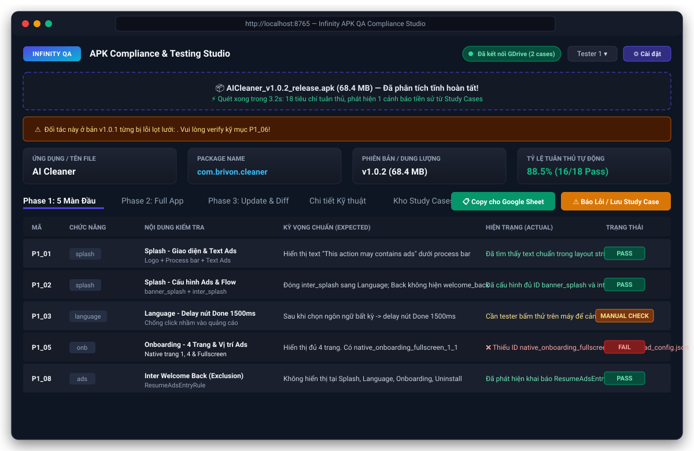
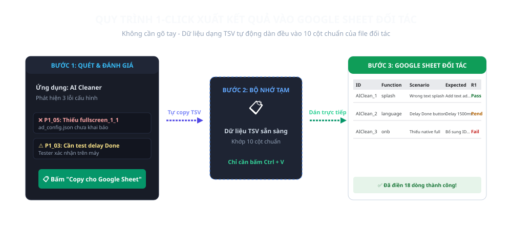
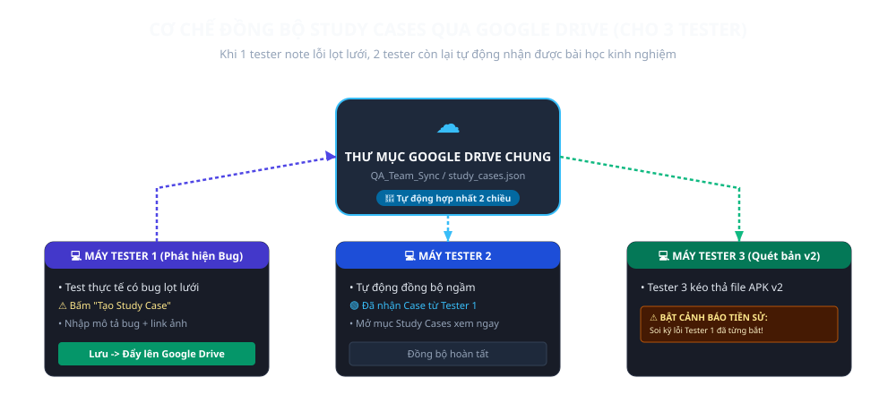

# KOG APK Tester Studio 🚀

Hệ thống kiểm thử tuân thủ tích hợp Ads & UI/UX chuẩn đối tác dành cho **Team Tester KOG Studio**, tích hợp **Trợ Lý AI Google Gemini**, **Bộ Máy Tự Học Quy Tắc (Self-Learning Rule Engine)**, và **Bộ Điều Khiển Android Emulator & Thiết Bị Thật**.


---

## 📸 Giao diện trực quan của hệ thống



---

## 🌟 Điểm nổi bật của KOG APK Tester Studio

1. **Chạy bằng 1 file `KOG_APK_Tester_Studio.exe` duy nhất (~12 MB)**:
   - Tester chỉ cần tải duy nhất 1 file `KOG_APK_Tester_Studio.exe` về máy tính và bấm đúp chuột là chạy ngay.
   - Hoàn toàn độc lập (Portable), không cần cài Python, Node.js, Java hay Docker.
2. **📱 Điều Khiển & Kiểm Thử Trên Emulator (Giả Lập) & Thiết Bị Thật**:
   - Tự động nhận diện thiết bị Android đang kết nối qua ADB: Giả lập (LDPlayer, BlueStacks, Nox, AVD) hoặc Máy thật cắm cáp USB.
   - **1-Click Cài đặt & Mở App**: Cài trực tiếp file APK vừa quét lên máy thật / giả lập.
   - **1-Click Chụp Màn Hình (Screenshot)**: Tự động chụp và lưu ảnh màn hình thiết bị làm bằng chứng bug.
   - **Live Ad Logcat**: Bắt trực tiếp luồng log quảng cáo (AdMob, AppLovin, IronSource, ITG, Tracking) theo thời gian thực để tester đối chiếu ngay trong trình duyệt.
3. **🧠 Bộ Máy Tự Học Quy Tắc (Self-Learning Rule Engine)**:
   - Khi tester phát hiện bug lọt lưới bằng test thủ công, tester có thể bấm **"Báo Lỗi Lọt Lưới & Dạy Hệ Thống"** và đính kèm file APK lỗi.
   - Hệ thống tự động bóc tách chữ ký lỗi (thiếu `enableUaCheck = true`, thiếu placement, thiếu event tracking, hoặc pattern code vi phạm) và tạo thành **Learned Rule**.
   - Ở các lần quét APK sau, nếu gặp phải lỗ hổng tương tự, hệ thống lập tức **BẬT CẢNH BÁO ĐỎ VÀ TỰ ĐỘNG CHẶN NGAY**, giúp hệ thống càng dùng càng thông minh!
4. **🤖 Tích Hợp KOG AI Assistant (Google Gemini 1.5 Flash)**:
   - Trợ lý AI tích hợp sẵn trên Web UI (Drawer trượt bên phải màn hình).
   - Nắm vững toàn bộ tài liệu **ITG Ads Integration Guide**, tiêu chuẩn UI/UX ERain-Studio và Checklist 3 Phase.
   - **1-Click AI Soạn Email Phản Hồi**: Tự động phân tích kết quả quét của APK hiện tại và soạn thảo email/tin nhắn chuyên nghiệp liệt kê cụ thể các lỗi cần đối tác sửa.
   - Có sẵn bộ **Tri Thức Offline ITG** giải đáp các câu hỏi thường gặp ngay cả khi mất mạng internet.
5. **📜 Nhật Ký Hoạt Động (Activity & Audit Logs)**:
   - Tự động ghi lại toàn bộ hành vi: Quét APK, thay đổi kết quả, báo Study Case, hỏi AI, copy Google Sheet...
   - Giúp việc quản lý kiểm thử minh bạch và dễ dàng rà soát lịch sử làm việc.
6. **🔒 Bảo Mật Thiết Bị Tương Tự KOG Studio (HWID Device Lock)**:
   - Tự động nhận diện Hardware ID (Machine UUID) của máy tính.
   - Hỗ trợ whitelist máy tester thông qua file `allowed_devices.json` đồng bộ trên Google Drive, có thể dùng chung cấu hình với KOG Studio.
7. **📁 Kho Lưu Trữ Google Drive Dùng Chung**:
   - Thư mục Google Drive mặc định: [KOG QA Study Cases Drive](https://drive.google.com/drive/folders/1IrayqTICONSxnd896T9ZeDgEiDH_wEUL?usp=drive_link).
   - Nút 1-click **"📁 Kho Study Cases (GDrive)"** trên thanh điều hướng mở ngay thư mục trên web.
8. **Checklist tương tác 3 Phase & Xuất Google Sheet 1-Click**:
   - Nút **"📋 Copy cho Google Sheet"** sao chép dữ liệu dạng TSV chuẩn xác 100% các cột:  
     `ID` | `Function` | `Test Scenario Group` | `Actual` | `Test Condition` | `Steps to Reproduce` | `Expected` | `Round 1` | `Round 2` | `Link Bug`
   - Tester chỉ cần bấm **`Ctrl + V`** vào Google Sheet đối tác là xong!

---

## 📋 Quy trình 1-Click đưa kết quả vào Google Sheet



---

## 🔄 Cơ chế đồng bộ Google Drive



---

## 🚀 Hướng dẫn nhanh cho Tester

### Cách 1: Tải và chạy file `.exe` trực tiếp (Khuyên dùng)
1. Tải file **`KOG_APK_Tester_Studio.exe`** từ mục **[Releases](https://github.com/KOG-KH/KOG-APK-Tester-Studio-Releases/releases)** của repo.
2. Bấm đúp chuột vào file `KOG_APK_Tester_Studio.exe` (hoặc chạy `Chay_KOG_APK_Tester_Studio.bat`).
3. Trình duyệt web sẽ tự động mở tại: **`http://localhost:8765`**.
4. Kéo thả file APK của đối tác vào và xem kết quả sau 3 giây!

### Cách cấu hình Google Drive & Gemini AI:
1. Trên giao diện Web, bấm nút **`⚙️ Cài đặt`** ở góc trên bên phải.
2. Nhập đường dẫn thư mục Google Drive chung nếu muốn đồng bộ offline (hoặc bấm nút `📁 Kho Study Cases (GDrive)` trên header để mở web).
3. Nhập **Gemini API Key** (nếu muốn kích hoạt AI trò chuyện chuyên sâu).
4. Nhập tên Tester của bạn.

---

## 🛠️ Dành cho Developer muốn chạy mã nguồn

```bash
# Clone repository
git clone https://github.com/KOG-KH/KOG-APK-Tester.git
cd KOG-APK-Tester

# Cài đặt thư viện cần thiết
pip install -r requirements.txt

# Chạy server
python main.py

# Đóng gói thành 1 file .exe duy nhất
python build_exe.py
```

---

## 📚 Tài liệu kỹ thuật tham chiếu

- [ERain-Studio Ad Integration Guide & UI/UX Standards](https://docs.itgproduct.com/s/android-sdk-publisher/doc/erain-studio-ad-integration-guide-uiux-standards-RBa1FbknOR)
- [Example-AdLogic-Partner Repository](https://github.com/Infinity-Technologies-Global/Example-AdLogic-Partner)
- [Tracking Events Master Sheet](https://docs.google.com/spreadsheets/d/1bUH11s0Cp8HHTJQTGJn3G4EywEqotl_XlvsUqtKlmQo/edit)
- [3-Phase Test Suite Checklist](https://docs.google.com/document/d/1ih1aL_cql7TpVTfjwxSoCI7AkbBVP06sZyhcJHUeKIE/edit)
- [Thư mục Study Cases Google Drive chung](https://drive.google.com/drive/folders/1IrayqTICONSxnd896T9ZeDgEiDH_wEUL?usp=drive_link)
